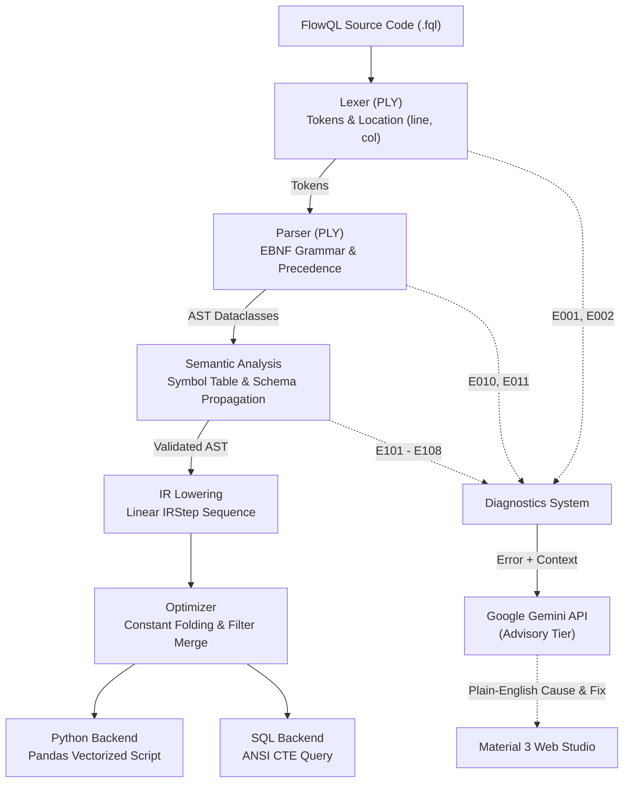

# FlowQL: AI-Assisted Mini Compiler & Studio

**Domain-Specific Language (DSL) for Tabular Data Pipelines**  
*College Semester Project — Compiler Design (B.Tech CS, Sem 5)*  
**Team Members:** Sarthak Zanwar, Meghshyam Pawar, Jash Panchal  

---

## Overview

FlowQL is a domain-specific language for building and running tabular data pipelines over CSV files. It translates declarative pipeline operations (`filter`, `select`, `group`, `sort`, `limit`) into high-performance **Python (pandas)** scripts or **ANSI SQL** queries (using Common Table Expressions). 

When errors occur, an advisory **Google Gemini AI** layer explains the root cause in plain English and suggests a fix directly in the web UI.

---

## 5-Step Quickstart

### Step 1: Clone or Navigate to the Workspace
```bash
cd flowql
```

### Step 2: Create and Activate a Virtual Environment
**On Windows:**
```powershell
python -m venv venv
.\venv\Scripts\activate
```
**On macOS / Linux:**
```bash
python3 -m venv venv
source venv/bin/activate
```

### Step 3: Install Dependencies
```bash
pip install -r requirements.txt
```

### Step 4 (Optional): Configure Google Gemini API Key
To enable advisory AI error diagnosis and code reviews, create a `.env` file from `.env.example`:
```bash
# On Windows PowerShell:
Copy-Item .env.example .env

# On macOS / Linux:
cp .env.example .env
```
Open `.env` and paste your free Google AI Studio key:
```env
GEMINI_API_KEY=your_gemini_api_key_here
GEMINI_MODEL=gemini-2.5-flash
```
*(Note: If no API key is provided, the compiler works 100% deterministically and displays a friendly notice that AI hints are unavailable).*

### Step 5: Launch the Web Studio
```bash
uvicorn server:app --reload
```
Open your browser at **[http://localhost:8000](http://localhost:8000)**.

---

## Screenshots

| Web Studio (Light Mode) | Web Studio (Dark Mode) |
| :---: | :---: |
|  |  |
| *Clean Material 3 Split Layout* | *Automatic & Persistent Theme Toggle* |

| AI Error Diagnostic & Quick Fix | Visual Pipeline IR Steps |
| :---: | :---: |
|  |  |
| *Plain English Cause + One-Click Apply Fix* | *Linear Intermediate Representation* |

---

## Command-Line Interface (CLI)

The compiler can also be driven from the command line:

```bash
# 1. Compile to Python (pandas)
python -m dslc compile examples/valid/top_regions.fql --target python

# 2. Compile to SQL (CTEs)
python -m dslc compile examples/valid/top_regions.fql --target sql --out pipeline.sql

# 3. Emit Compiler Stages for Demo & Viva
python -m dslc compile examples/valid/top_regions.fql --emit tokens
python -m dslc compile examples/valid/top_regions.fql --emit ast
python -m dslc compile examples/valid/top_regions.fql --emit ir

# 4. Syntax & Semantic Check Only
python -m dslc check examples/valid/top_regions.fql

# 5. Compile with AI Advisory Diagnostic
python -m dslc compile examples/invalid/err_unknown_column.fql --ai
```

---

## Running the Automated Test Suite

Run the full offline test suite (all 32 tests execute with zero network calls; Gemini calls are mocked):

```bash
pytest -v
```

Tests verify:
- Lexer tokenization, column tracking, and comment handling.
- Parser precedence, AST generation, and error recovery at semicolons.
- Symbol tables, schema propagation, and error codes `E101`–`E108`.
- Constant folding and consecutive filter merging optimizations.
- Code generators and **SQLite execution equivalence** matching pandas output.
- FastAPI backend endpoints and static asset serving.

---

## Compiler Architecture



---

## Standard Compiler Error Codes

| Code | Phase | Description |
|---|---|---|
| `E001` | Lexer | Illegal character encountered |
| `E002` | Lexer | Unterminated string literal |
| `E010` | Parser | Unexpected token (syntax error) |
| `E011` | Parser | Unexpected end of input (EOF) |
| `E101` | Semantic | Undefined dataset or variable |
| `E102` | Semantic | Redeclaration of an identifier |
| `E103` | Semantic | Unknown column for current schema |
| `E104` | Semantic | Type mismatch in expression |
| `E105` | Semantic | `filter` expression is not boolean |
| `E106` | Semantic | `sum` or `avg` on non-numeric column |
| `E107` | Semantic | `limit` count is not a positive integer |
| `E108` | Semantic | `print` of undefined or non-table variable |

---

## Viva Presentation Cheat-Sheet

1. **How does error recovery work in the parser?**  
   We implemented an `error SEMICOLON` rule in PLY (`dslc/parser.py`). When a syntactic error occurs, the parser logs the token with exact line/column, then discards tokens until the next semicolon `;`, allowing multiple errors across statements to be reported in one go.

2. **How is schema propagation handled?**  
   `dslc/semantic.py` maintains an ordered dictionary of `{col_name: col_type}` for each table. When a pipeline stage executes:
   - `filter`: Validates that the predicate evaluates to `bool`, schema remains intact.
   - `select`: Filters the schema down to only the requested columns in specified order.
   - `group`: Drops non-key columns and produces `{key_col: type, <agg>_<col>: "num"}`.
   - `sort` & `limit`: Validates columns and types, propagating the schema unchanged.

3. **How does the optimizer work?**  
   `dslc/optimizer.py` executes two passes on the IR:
   - *Constant Folding:* Recursively simplifies expressions containing only literal values (e.g. `25 * 2 + 50` $\to$ `100`).
   - *Filter Merging:* Identifies consecutive `filter` steps in a pipeline and merges them into a single `and` predicate step.

4. **Is AI required for compilation?**  
   No. The entire compiler (phases 1–6) is 100% deterministic and runs offline with zero external network dependencies. Gemini is strictly an advisory assistant that explains errors and reviews output code.
